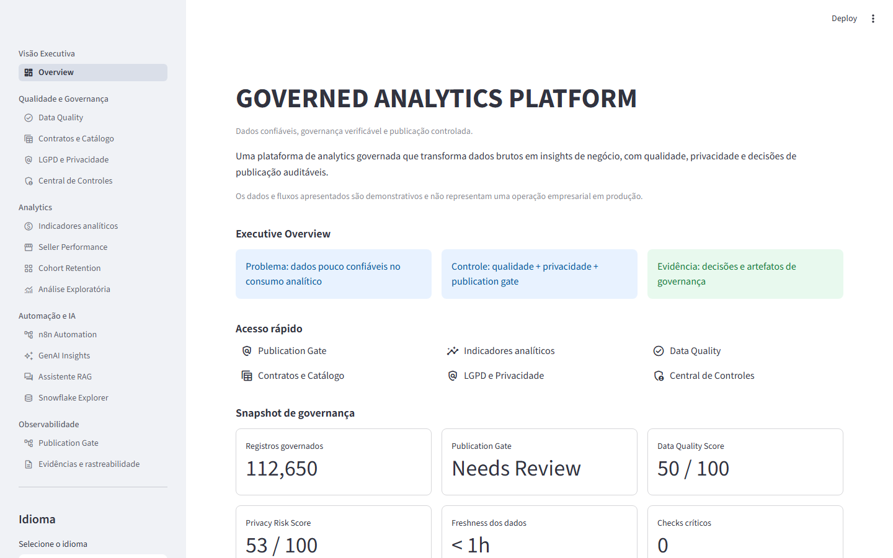
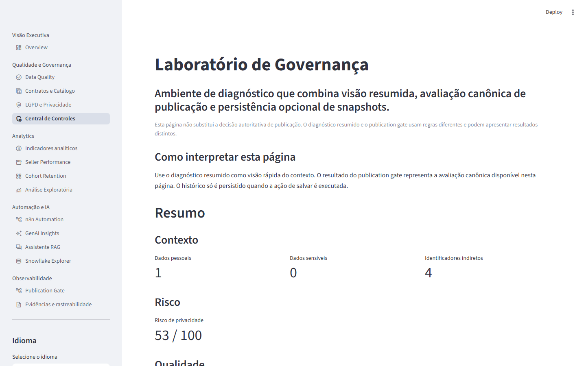
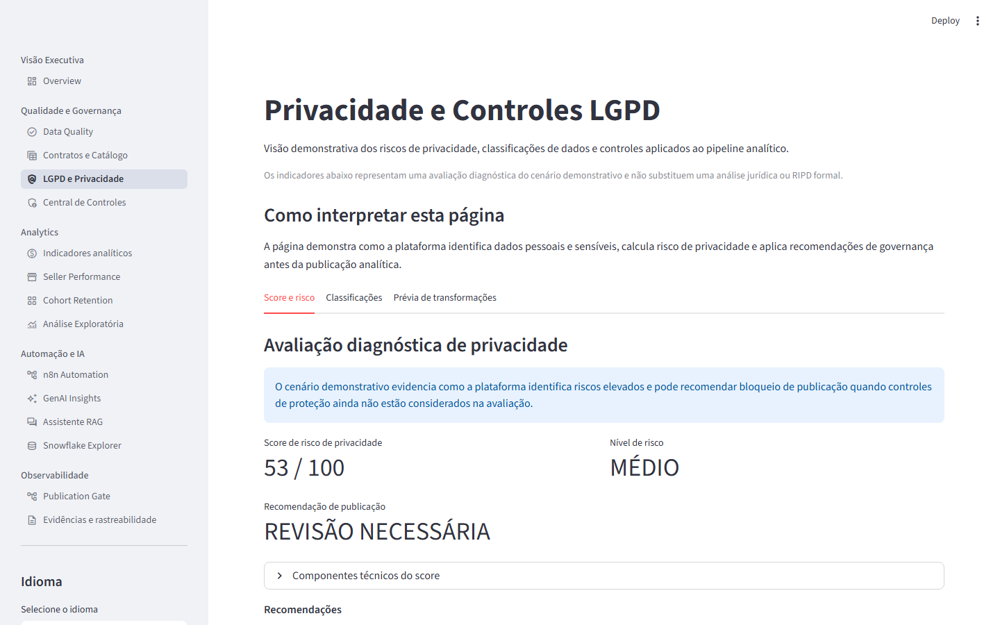
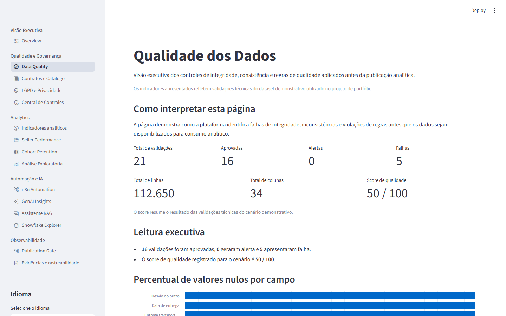
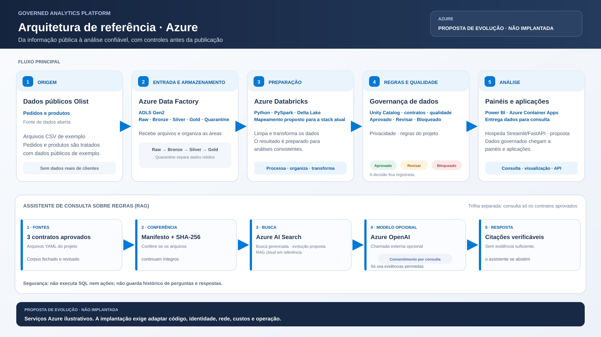

# Governed Analytics Platform

**Language:** `English` · [Português (Brasil)](README.md)

[](https://github.com/samuelmaia-analytics/Governed-Analytics-Platform/actions/workflows/ci.yml)
[](https://github.com/samuelmaia-analytics/Governed-Analytics-Platform/actions/workflows/lint.yml)
[](LICENSE)

A personal portfolio platform that turns public Olist e-commerce data into analytical assets with quality checks, privacy classification, contracts, lineage and publication decision evidence.

[Open the demonstration](https://governed-analytics-platform.streamlit.app/)

## Executive interface update — 14 November 2026

The Streamlit application now provides a refreshed Executive Overview, grouped sidebar navigation, reusable metric cards and clear historical evidence labels. Operational indicators come from available sources, with explicit missing-evidence states; the visual redesign does not change publication rules. See the [interface commit](https://github.com/samuelmaia-analytics/Governed-Analytics-Platform/commit/8dc43e7a9c8bdc8714901c62810b9c0723d7c884) and [typing fix](https://github.com/samuelmaia-analytics/Governed-Analytics-Platform/commit/1219c6a4d640b00d9c249eda8d9f3951ecd82ee4). CI, lint, security, policy and Streamlit deploy workflows passed on the latter commit. Updated local interface captures are available in the application screenshots section.

The **1,353 passing tests and 92% coverage** are from the separate **13 November 2026 local run**, not inferred from the CI badge. This is a personal demonstration project, not an enterprise deployment.

## Capabilities and evidence

- Python and SQL ingestion, transformation and analytical modeling.
- dbt + DuckDB staging, intermediate and marts models, executed independently of the Python orchestration entrypoint.
- Data Contracts, Data Quality, Data Lineage and explainable Privacy Risk Score.
- A deterministic Publication Gate evaluator with `Approved`, `Needs Review` and `Blocked` decisions, used by the Governance Control Center.
- Streamlit executive views, FastAPI endpoints, operational artifacts and GitHub Actions checks.
- Optional Snowflake integration and versioned n8n workflow templates.
- A governance RAG assistant with local TF-IDF retrieval, citations and an approved-contract corpus.

The documented governance review on **24 October 2026** passed **383 tests**, including invalid Gate evidence cases. This is a historical result, not a new test run or a guarantee that all execution paths use one promotion gate.

### Latest verified run (local)

Verified results from **Checkpoint 16C** on **13 Nov 2026** (local execution; it does not automatically match GitHub Actions or Codecov metrics):

- Collected tests: **1,353**
- Passed: **1,353**
- Failures/errors/skips: **0/0/0**
- Total coverage: **92%** (scope: `src` + `app`)
- Python: **3.11.18** · Pytest: **9.0.3**

Equivalent command (PowerShell, from the repository root):

```powershell
.\.venv\Scripts\python.exe -m pytest -q -p no:cacheprovider --cov=src --cov=app --cov-report=term-missing
```

Note: coverage data was stored in a temporary directory **outside the repository**, avoiding `.coverage`, `htmlcov/` or `coverage.xml` artifacts in the working tree.


## Application screenshots

Real local Streamlit captures at **1440 × 900**, pixel scale 1:1, without resizing. Results reflect the demonstration dataset and may vary between runs. [Capture runbook](docs/operations/streamlit_capture_runbook.md).

| Executive Overview | Governance Control Center |
|---|---|
|  |  |

| LGPD & Privacy Risk | Data Quality |
|---|---|
|  |  |

## Architecture and publication boundary



[Open the high-resolution SVG](docs/assets/architecture-overview.svg) · [Mermaid source](docs/assets/architecture-overview.mmd)

**This is a proposed Azure reference design, not deployed infrastructure.** Azure Data Factory, ADLS Gen2, Azure Databricks, Unity Catalog, Azure AI Search, Azure OpenAI, Azure Container Apps and Power BI are illustrative target services. The current project uses local processing and a Streamlit demo; its RAG assistant uses local TF-IDF retrieval and an optional OpenAI API call after per-query consent. Moving the project to Azure would require code changes and provisioning.

The Gate evaluator is implemented, but enforcement differs across entrypoints. See [the technical architecture](docs/architecture/architecture.md) for the Python/dbt execution boundaries and remaining work.

## Generative AI for product attributes

The src/genai_feature_extraction.py module extracts category, material, compatibility, features and summaries from product descriptions with prompts and structured JSON output. Results are persisted as CSV and JSONL. The reference mode uses versioned reference data; openai calls the API when credentials are configured. The UI displays persisted results and does not run inference on page load.

[Module](src/genai_feature_extraction.py) · [Documentation](docs/genai_bonus.md)

## Governance RAG assistant

A separate RAG assistant answers questions grounded in approved technical contracts, using local TF-IDF retrieval, cited source excerpts and abstention when evidence is insufficient.

- **Corpus:** only three versioned contracts under contracts/, approved in a manifest and checked by SHA-256. Local-only documents, generated reports, raw data and files outside this scope are excluded.
- **Local mode:** TF-IDF is the default and needs no API key, vector database or network. Source files are revalidated for each query.
- **Optional OpenAI mode:** an external call requires explicit mode selection and consent for that query, plus server-side credentials. The integration selects supporting evidence and requires literal citations; it does not execute SQL, tools or publication decisions.
- **Limits:** external context is limited to five chunks and 7,000 characters; questions and answers are not persisted as application history.
- **Security and setup:** [RAG documentation](docs/governance_rag.md) covers sources, hashes, consent, secrets, limits, costs and the local walkthrough.

The integration review recorded on **31 October 2026** passed **1,111 tests, zero skips and 92% coverage**. This is a historical milestone; for the latest verified execution (13 Nov 2026), see **Latest verified run (local)**.

## FastAPI authentication

Sensitive endpoints require **Bearer authentication**. Set the server token via `GAP_API_BEARER_TOKEN`. On the client, send `Authorization: Bearer <token>` using the same value. Avoid logging tokens or leaking them in shell history.

- `/health` is public.
- If `GAP_API_BEARER_TOKEN` is not configured on the server: sensitive endpoints return **503** (fail-closed).
- Missing/malformed `Authorization` header: **401**.
- Invalid token: **403**.

Example (bash):

```bash
export API_TOKEN="YOUR_TOKEN_HERE"
curl -sS -H "Authorization: Bearer $API_TOKEN" http://localhost:8000/api/v1/governance/status
```

Example (Windows PowerShell):

```powershell
$env:API_TOKEN = "YOUR_TOKEN_HERE"
Invoke-RestMethod -Headers @{ Authorization = "Bearer $env:API_TOKEN" } -Uri "http://localhost:8000/api/v1/governance/status"
```

Limitations: the token is shared and does **not** implement RBAC/ABAC (fine-grained authorization). Enterprise deployments should use proper secret management and identity-based authorization.

## Run locally

Requires Python 3.11 or later. From the repository root on Linux/macOS:

```bash
python -m venv .venv
source .venv/bin/activate
make install
cp .env.example .env
make test
make app
```

On Windows PowerShell, use `uv sync --extra dev`, `Copy-Item .env.example .env`, then `uv run streamlit run app/main.py`. Run focused UI tests with `uv run python -m pytest -q tests/test_app_main.py tests/test_app_pages_rendering.py`. Never commit credentials.

## Documentation

- [Architecture](docs/architecture/architecture.md)
- [dbt modeling](dbt/README.md)
- [Documentation index](docs/README.en.md)
- [Access and retention policy](docs/governance/access_and_retention_policy.md)
- [Detailed project overview in Portuguese](README.md)

## Scope

Production-inspired portfolio work using public, sample or synthetic data. Legal roles and governance context are demonstrative; enterprise IAM and centralized audit are not fully implemented. AWS is a proposed design. This project does not constitute legal certification of LGPD compliance.

## Author

**Samuel de Andrade Maia — Data Engineer (Pleno) | Analytics Engineer**

Data Engineering at **Avanade** since **20 October 2026**. This personal portfolio project does not represent work, data or results delivered for Avanade or its clients.

[LinkedIn](https://www.linkedin.com/in/samuelmaia-analytics/) · [Portfolio](https://samuelmaia-analytics.github.io/samuelmaia-analytics/)

## License

**Creative Commons Attribution-NonCommercial 4.0 International (CC BY-NC 4.0)**. See [LICENSE](LICENSE) and the [dashboard notice](DASHBOARD_LICENSE_NOTICE.txt).
