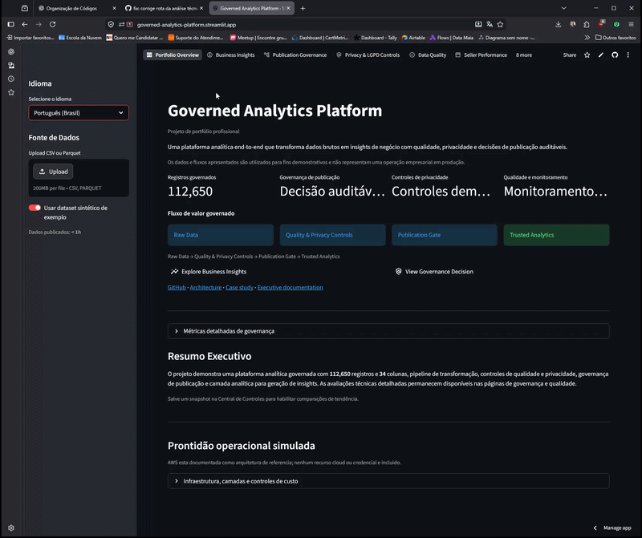
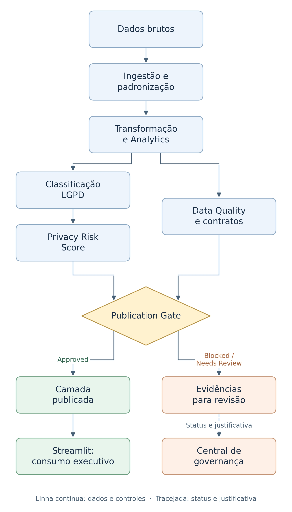
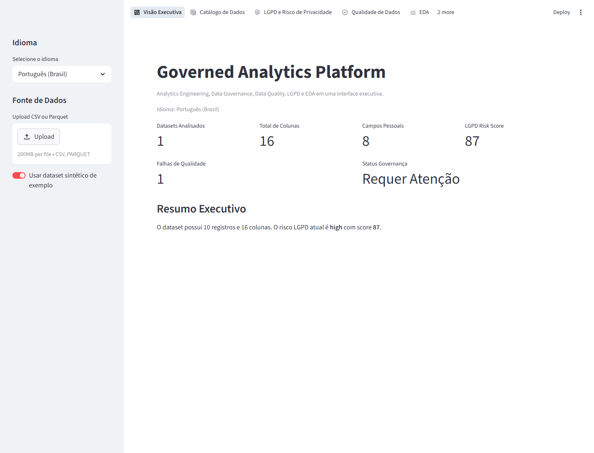
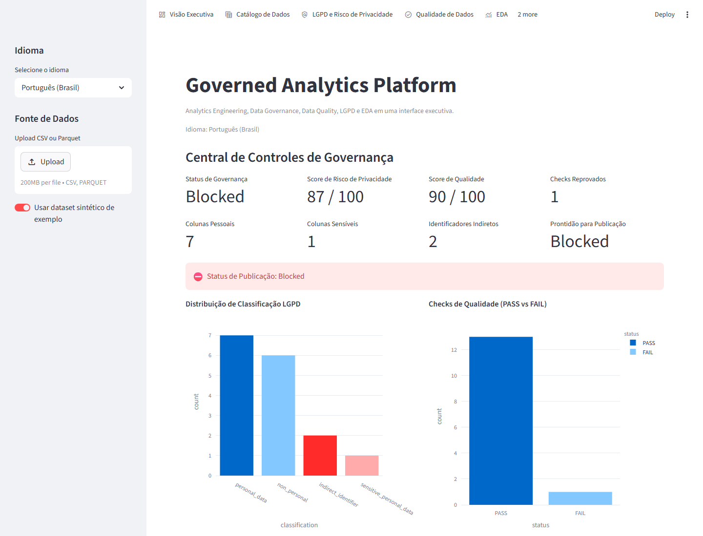
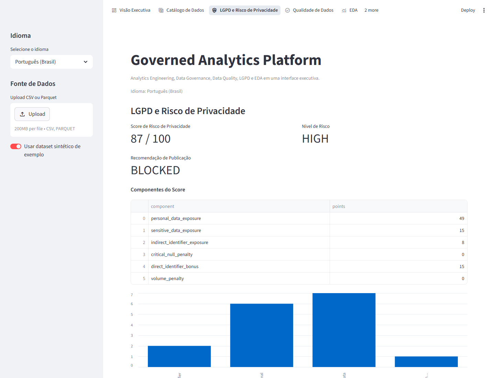
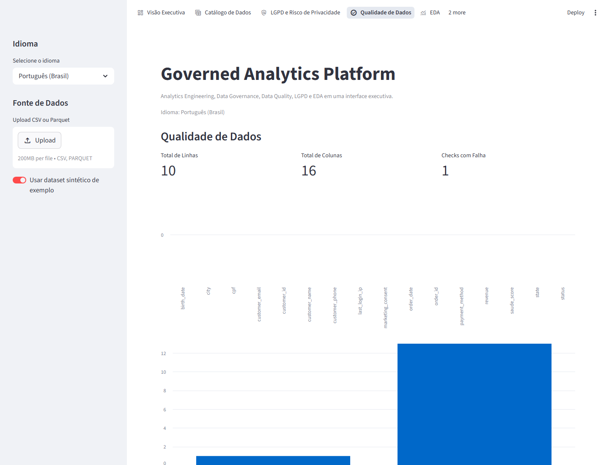

# Governed Analytics Platform

[](https://github.com/samuelmaia-analytics/Governed-Analytics-Platform/actions/workflows/ci.yml)
[](https://github.com/samuelmaia-analytics/Governed-Analytics-Platform/actions/workflows/lint.yml)
[](https://www.python.org/)
[](https://codecov.io/gh/samuelmaia-analytics/Governed-Analytics-Platform)
[](https://governed-analytics-platform.streamlit.app/)
[](LICENSE)

**Idioma:** `Português` · [English](README.en.md)

> Dados de e-commerce podem chegar ao consumo analítico sem controle suficiente de qualidade, rastreabilidade ou critério claro de publicação. Para enfrentar esse problema, construí uma plataforma de Analytics Engineering em Python, SQL e dbt com Data Quality, Data Contracts, Data Lineage, Privacy Risk Score e um Publication Gate que aprova, revisa ou bloqueia a publicação. O resultado é um fluxo em que mudanças e dados inadequados podem ser detectados antes de chegar ao consumo executivo, reduzindo o risco de decisões apoiadas em informação inconsistente.

**[→ Abrir demonstração ao vivo](https://governed-analytics-platform.streamlit.app/)**

---

## Resultados e evidências

A publicação passa por três estados explícitos — `Approved`, `Needs Review` e `Blocked` — e a arquitetura mantém evidências de qualidade e governança antes do consumo. Na revisão de governança de 24/10/2026, a suíte completa passou com **383 testes**, incluindo validações de entradas inválidas do Gate. Esse resultado corresponde à revisão documentada; execuções posteriores podem alterar a contagem.

---

## Demonstração visual



**Fluxo demonstrado:** ingestão → transformação → qualidade → governança → publicação → consumo analítico.

---

## O que este projeto resolve

O Governed Analytics Platform foi criado para demonstrar como uma solução de dados pode ir além de dashboards e incorporar controles de qualidade, privacidade, rastreabilidade e publicação.

A aplicação utiliza dados públicos do e-commerce Olist e mantém uma separação clara entre dados internos de processamento e a camada governada disponibilizada para consumo executivo.

### Principais entregas

- Pipeline modular em Python e SQL para ingestão, transformação e construção de ativos analíticos.
- Modelagem analítica com dbt e camadas Bronze, Silver, Gold e Quarantine.
- Data Quality com validações automatizadas e evidências de execução.
- Data Contracts em YAML para schema, regras e políticas de publicação.
- Classificação inspirada na LGPD e cálculo explicável de Privacy Risk Score.
- Publication Gate com decisões `Approved`, `Needs Review` e `Blocked`.
- Data Lineage, logs operacionais, monitoramento e evidências de governança.
- Aplicação executiva em Streamlit e endpoints em FastAPI.
- Testes, linting e CI/CD com GitHub Actions.
- Exemplos de orquestração com n8n, mantendo a lógica de negócio versionada em código.

### Escopo mensurável

As métricas abaixo descrevem componentes realmente implementados e versionados no repositório, sem estimar ganhos financeiros ou percentuais de produtividade não medidos:

- **4 camadas de dados:** Bronze, Silver, Gold e Quarantine.
- **3 estados de publicação:** `Approved`, `Needs Review` e `Blocked`.
- **7 workflows no GitHub Actions:** CI, deploy do Streamlit, lint, operação da camada publicada, policy check, segurança e sincronização de catálogo.
- **1 aplicação executiva em Streamlit** com integração a endpoints FastAPI.
- Controles versionados de **Data Quality, Data Contracts, Data Lineage, Privacy Risk Score e Publication Gate**.

---

## Arquitetura



[Abrir diagrama em alta resolução](docs/assets/architecture-overview.png) · [Versão vetorial](docs/assets/architecture-overview.svg) · [Fonte Mermaid](docs/assets/architecture-overview.mmd)

As setas contínuas representam o fluxo de dados e controles. A seta tracejada leva apenas status e justificativas para a central de governança; não representa publicação de dados bloqueados.

O armazenamento S3 é uma [arquitetura de referência](docs/architecture/aws_reference_architecture.md); as camadas locais não representam buckets AWS provisionados.

### Impacto demonstrado

- Reduz o risco de exposição ao separar processamento interno da camada publicada.
- Aumenta a confiança nos dados com critérios explícitos de qualidade e publicação.
- Facilita auditoria e revisão técnica com contratos, lineage, logs e evidências reproduzíveis.
- Torna o estado de publicação compreensível também para usuários não técnicos.

---

## Stack principal

| Área | Tecnologias |
|---|---|
| Processamento e análise | Python · pandas · DuckDB · SQL |
| Analytics Engineering | dbt · modelagem analítica · ETL/ELT |
| Qualidade e governança | pytest · Data Contracts (YAML) · Ruff · mypy |
| Visualização e entrega | Streamlit · Power BI · FastAPI |
| Automação e CI/CD | GitHub Actions · Codecov · n8n |
| Cloud / integração | Snowflake opcional · arquitetura AWS de referência |
| IA generativa | OpenAI API · prompts · extração de atributos textuais · JSON · CSV/JSONL |

---

## IA generativa aplicada a dados de produtos

**Contexto:** descrições de produtos chegam como texto livre, enquanto análises de categoria, material e compatibilidade precisam de atributos estruturados.

**Ação:** implementei um módulo em Python integrado à API da OpenAI, com engenharia de prompts e resposta JSON, para extrair categoria, material, compatibilidade, características e resumo. O pipeline normaliza as saídas e persiste os atributos em CSV e JSONL.

**Resultado:** descrições textuais passam a ter atributos estruturados e rastreáveis por produto, disponíveis para consumo analítico na página GenAI do Streamlit.

**Escopo implementado:** o módulo oferece o modo `reference`, com saída de referência versionada, e o modo `openai`, que chama a API mediante configuração de credenciais. A interface exibe o artefato persistido e não executa inferência ao ser aberta. Esta implementação é de extração estruturada com LLM; não inclui RAG.

- [Módulo de extração](src/genai_feature_extraction.py)
- [Interface de resultados persistidos](app/pages/genai_insights.py)
- [Documentação do experimento](docs/genai_bonus.md)

---

## Implementado x simulado

### Implementado

- Pipeline modular e execução reproduzível.
- Classificação de colunas por heurísticas e regras de contrato.
- Privacy Risk Score e lógica de decisão de publicação.
- Regras de Data Quality e artefatos de evidência.
- Views executivas em Streamlit com justificativa de publicação.
- Testes, linting, mypy e workflows de CI.
- Endpoints FastAPI para governança e integração com Snowflake.
- Integração Snowflake com graceful degradation quando não há credenciais.

### Simulado / demonstrativo

- Metadados de controlador, operador e DPO com entidades fictícias.
- Mini RIPD para demonstração.
- Base legal e retenção representadas para simulação de governança.
- Arquitetura AWS apresentada como referência, não como infraestrutura produtiva de cliente real.

> Projeto de portfólio inspirado em práticas de produção. Utiliza dados públicos, sintéticos ou demonstrativos e não representa certificação jurídica de conformidade com a LGPD.

---

## Visão da aplicação

| Executive Overview | Governance Control Center |
|---|---|
|  |  |

| LGPD & Privacy Risk | Data Quality |
|---|---|
|  |  |

---

## Como revisar este projeto em 5 minutos

1. Assista ao GIF no início deste README.
2. Abra a **[demonstração ao vivo](https://governed-analytics-platform.streamlit.app/)**.
3. Visite **Governance Control Center**, **Data Quality** e **LGPD & Privacy Risk**.
4. Consulte a arquitetura e a documentação técnica em `docs/`.
5. Revise `Implementado x simulado` para distinguir funcionalidades reais de componentes demonstrativos.

---

## Executar localmente

### Windows PowerShell

```powershell
python -m venv .venv
.venv\Scripts\Activate.ps1
make install
copy .env.example .env
make test
make app
```

### Linux / macOS

```bash
python -m venv .venv
source .venv/bin/activate
make install
cp .env.example .env
make test
make app
```

---

## Documentação e links

- **Aplicação:** https://governed-analytics-platform.streamlit.app/
- **Repositório:** https://github.com/samuelmaia-analytics/Governed-Analytics-Platform
- **Documentação técnica:** [`docs/`](docs/)
- **Documentação em inglês:** [`docs/README.en.md`](docs/README.en.md)
- **Data Contracts:** [`contracts/`](contracts/)
- **Workflows n8n:** [`workflows/n8n/`](workflows/n8n/)

---

## Validação de evidências do Publication Gate

O Gate rejeita evidências malformadas antes de decidir a publicação: scores
precisam ser finitos e estar entre 0 e 100, falhas críticas precisam ser um inteiro
não negativo, estados de freshness/contrato precisam ser reconhecidos e a indicação
de dados sensíveis sem proteção precisa ser booleana. Valores desconhecidos,
`NaN` ou ausência de evidência geram erro; não são convertidos em aprovação.

Para verificar os casos normais, limites e entradas inválidas:

```bash
uv sync --extra dev
uv run pytest -q tests/test_publication_gate.py tests/test_governance_edge_cases.py
uv run ruff check src app tests
```

Esses controles complementam a política de publicação. O modelo de acesso e
retenção permanece demonstrativo, conforme a
[política de acesso e retenção](docs/governance/access_and_retention_policy.md).

## Licença

Este projeto utiliza a licença **Creative Commons Atribuição-NãoComercial 4.0 Internacional (CC BY-NC 4.0)**. Consulte os termos completos em [LICENSE](LICENSE) e o [aviso do dashboard](DASHBOARD_LICENSE_NOTICE.txt).

## Autor

**Samuel de Andrade Maia — Engenheiro de Dados Pleno | Analytics Engineer**

Atuo na **Avanade** desde **20/10/2026**, em Engenharia de Dados. Este é um **projeto pessoal de portfólio**; suas implementações, dados e resultados não representam entregas da Avanade ou de seus clientes.

[LinkedIn](https://www.linkedin.com/in/samuelmaia-analytics/) · [Portfólio](https://samuelmaia-analytics.github.io/samuelmaia-analytics/) · [Currículo em PDF](https://samuelmaia-analytics.github.io/samuelmaia-analytics/assets/Samuel_Maia_Curriculo.pdf)
