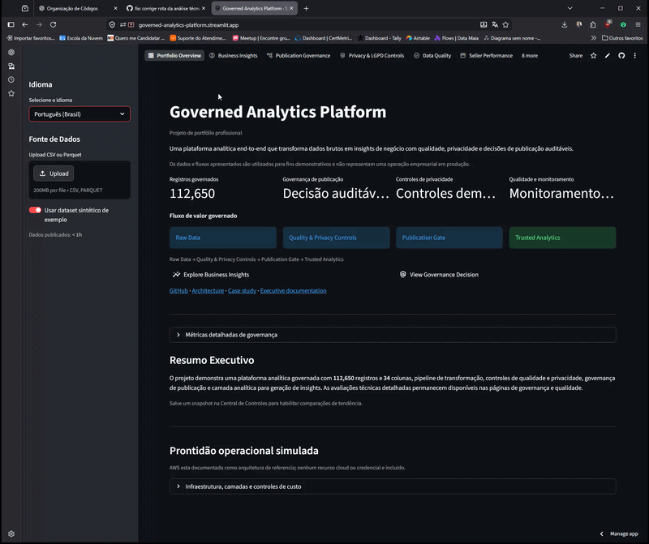
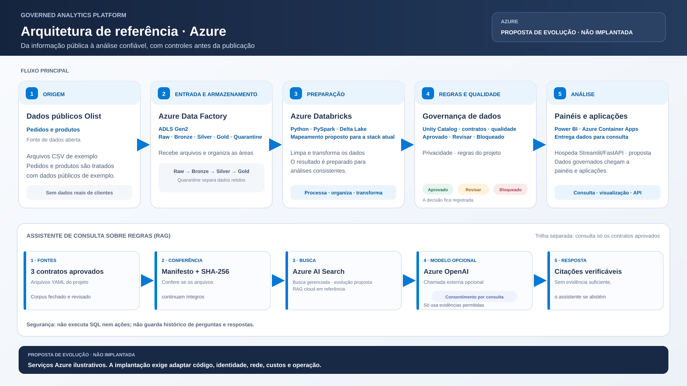
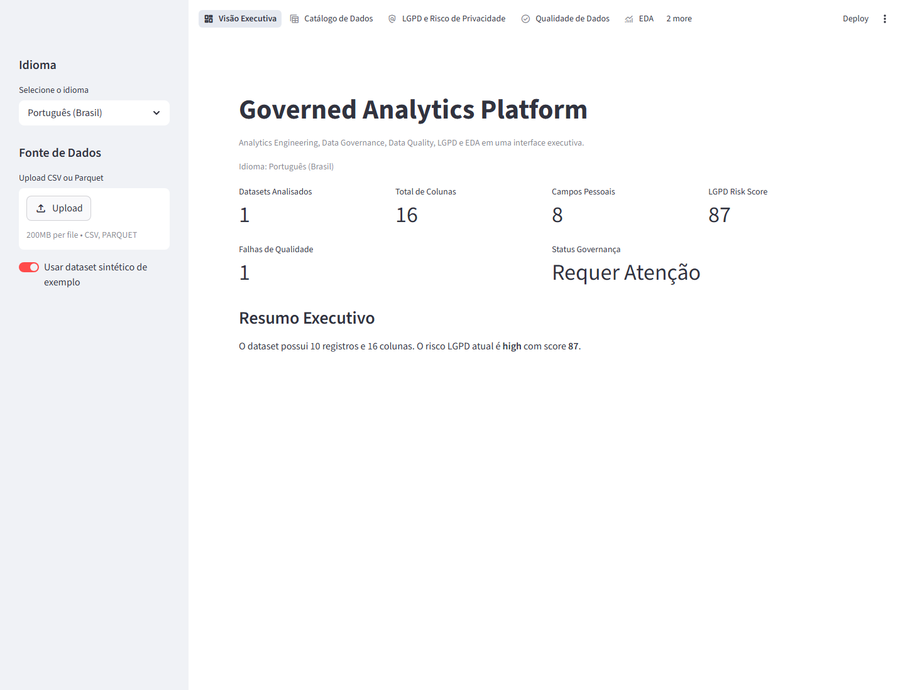
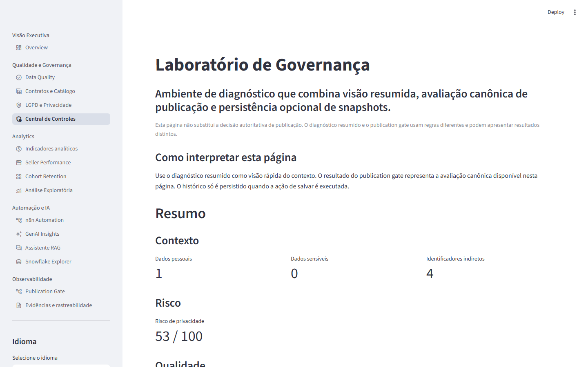
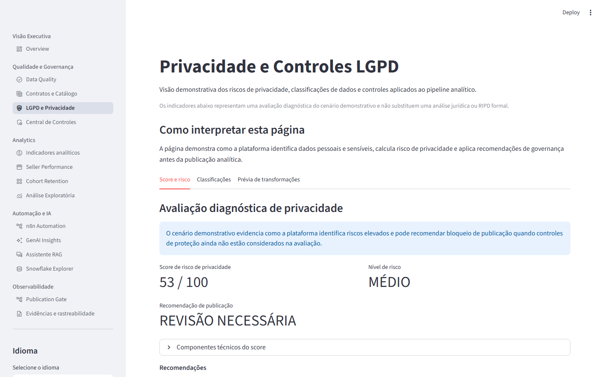
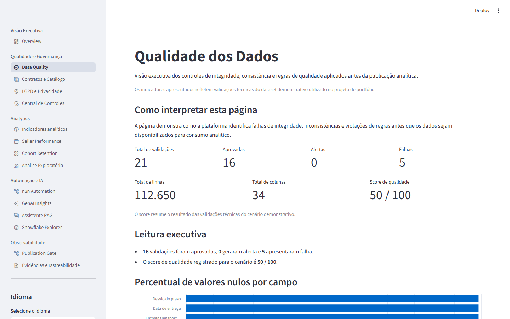

# Governed Analytics Platform

[](https://github.com/samuelmaia-analytics/Governed-Analytics-Platform/actions/workflows/ci.yml)
[](https://github.com/samuelmaia-analytics/Governed-Analytics-Platform/actions/workflows/lint.yml)
[](https://www.python.org/)
[](https://codecov.io/gh/samuelmaia-analytics/Governed-Analytics-Platform)
[](https://governed-analytics-platform.streamlit.app/)
[](LICENSE)

**Idioma:** `Português` · [English](README.en.md)

> Dados de e-commerce podem chegar ao consumo analítico sem controle suficiente de qualidade, rastreabilidade ou critério claro de publicação. Para enfrentar esse problema, construí uma plataforma de Analytics Engineering em Python, SQL e dbt com Data Quality, Data Contracts, Data Lineage, Privacy Risk Score e um Publication Gate que aprova, revisa ou bloqueia a publicação. O resultado é um fluxo em que mudanças e dados inadequados podem ser detectados antes de chegar ao consumo executivo, reduzindo o risco de decisões apoiadas em informação inconsistente.

**[→ Abrir demonstração ao vivo](https://governed-analytics-platform.streamlit.app/)**

---

## Resultados e evidências

A publicação passa por três estados explícitos — `Approved`, `Needs Review` e `Blocked` —, com evidências de qualidade e governança antes do consumo. A validação local mais recente, em **13/11/2026**, registrou **1.353 testes aprovados**, **92% de cobertura** em `src` + `app` e **nenhuma falha**. São resultados da execução local, não métricas atribuídas ao GitHub Actions ou ao Codecov. Como histórico, a revisão de 24/10/2026 registrou **383 testes**, e a de 31/10/2026 registrou **1.111 testes**.
### Validação de qualidade (execução local)

Resultados verificados no **Checkpoint 16C** em **13/11/2026** (execução local; não equivale automaticamente aos números do workflow do GitHub Actions ou do Codecov):

- Testes coletados: **1.353**
- Testes aprovados: **1.353**
- Falhas/erros/skips: **0/0/0**
- Cobertura total: **92%** (escopo: `src` + `app`)
- Python: **3.11.18** · Pytest: **9.0.3**

Comando equivalente utilizado (PowerShell, na raiz do projeto):

```powershell
.\.venv\Scripts\python.exe -m pytest -q -p no:cacheprovider --cov=src --cov=app --cov-report=term-missing
```

Nota: a coleta/armazenamento de dados de cobertura foi isolada em diretório temporário **fora do repositório**, para evitar criação de artefatos (`.coverage`, `htmlcov/`, `coverage.xml`) no working tree.


---

## Interface executiva e observabilidade

A aplicação Streamlit foi modernizada em **14/11/2026** com uma **Executive Overview** mais clara, cards de indicadores, navegação lateral por áreas, acesso às páginas existentes e apresentação explícita de evidências históricas. Os indicadores operacionais utilizam fontes disponíveis na execução; na ausência de dados, a interface informa a indisponibilidade em vez de inventar números. A modernização preserva o processamento e as regras de governança existentes.

A mudança foi publicada no commit [`8dc43e7`](https://github.com/samuelmaia-analytics/Governed-Analytics-Platform/commit/8dc43e7a9c8bdc8714901c62810b9c0723d7c884) e recebeu uma [correção de tipagem](https://github.com/samuelmaia-analytics/Governed-Analytics-Platform/commit/1219c6a4d640b00d9c249eda8d9f3951ecd82ee4). No commit de correção, os workflows **CI, Lint, Security, Policy Check e Deploy Streamlit** terminaram com sucesso. Esses checks não comprovam implantação corporativa nem substituem o escopo da validação local de 13/11/2026.

[Executar demonstração](https://governed-analytics-platform.streamlit.app/) · [Conferir os workflows](https://github.com/samuelmaia-analytics/Governed-Analytics-Platform/actions)

---

## Demonstração visual



**Fluxo demonstrado:** ingestão → transformação → qualidade → governança → publicação → consumo analítico.

---

## O que este projeto resolve

O Governed Analytics Platform foi criado para demonstrar como uma solução de dados pode ir além de dashboards e incorporar controles de qualidade, privacidade, rastreabilidade e publicação.

A aplicação utiliza dados públicos do e-commerce Olist e mantém uma separação clara entre dados internos de processamento e a camada governada disponibilizada para consumo executivo.

### Principais entregas

- Pipeline modular em Python e SQL para ingestão, transformação e construção de ativos analíticos.
- Modelagem analítica com dbt e camadas Bronze, Silver, Gold e Quarantine.
- Data Quality com validações automatizadas e evidências de execução.
- Data Contracts em YAML para schema, regras e políticas de publicação.
- Classificação inspirada na LGPD e cálculo explicável de Privacy Risk Score.
- Publication Gate com decisões `Approved`, `Needs Review` e `Blocked`.
- Data Lineage, logs operacionais, monitoramento e evidências de governança.
- Aplicação executiva em Streamlit e endpoints em FastAPI.
- Testes, linting e CI/CD com GitHub Actions.
- Exemplos de orquestração com n8n, mantendo a lógica de negócio versionada em código.
- Assistente RAG de governança com recuperação TF-IDF local, citações e corpus limitado a contratos aprovados.

### Escopo mensurável

As métricas abaixo descrevem componentes realmente implementados e versionados no repositório, sem estimar ganhos financeiros ou percentuais de produtividade não medidos:

- **4 camadas de dados:** Bronze, Silver, Gold e Quarantine.
- **3 estados de publicação:** `Approved`, `Needs Review` e `Blocked`.
- **7 workflows no GitHub Actions:** CI, deploy do Streamlit, lint, operação da camada publicada, policy check, segurança e sincronização de catálogo.
- **1 aplicação executiva em Streamlit** com integração a endpoints FastAPI.
- Controles versionados de **Data Quality, Data Contracts, Data Lineage, Privacy Risk Score e Publication Gate**.

---

## Arquitetura



[Abrir diagrama em alta resolução (SVG)](docs/assets/architecture-overview.svg) · [Fonte Mermaid](docs/assets/architecture-overview.mmd)

**Arquitetura proposta, ainda não implantada.** O desenho mostra um possível mapeamento para Azure: Data Factory, ADLS Gen2, Azure Databricks, Unity Catalog, Azure AI Search, Azure OpenAI, Azure Container Apps e Power BI são serviços de referência. A implementação atual usa processamento local e a demonstração em Streamlit; o assistente RAG usa TF-IDF local e a OpenAI API opcional. Levar o projeto para Azure exige adaptação do código e provisionamento dos serviços.


### Impacto demonstrado

- Reduz o risco de exposição ao separar processamento interno da camada publicada.
- Aumenta a confiança nos dados com critérios explícitos de qualidade e publicação.
- Facilita auditoria e revisão técnica com contratos, lineage, logs e evidências reproduzíveis.
- Torna o estado de publicação compreensível também para usuários não técnicos.

---

## Stack principal

| Área | Tecnologias |
|---|---|
| Processamento e análise | Python · pandas · DuckDB · SQL |
| Analytics Engineering | dbt · modelagem analítica · ETL/ELT |
| Qualidade e governança | pytest · Data Contracts (YAML) · Ruff · mypy |
| Visualização e entrega | Streamlit · Power BI · FastAPI |
| Automação e CI/CD | GitHub Actions · Codecov · n8n |
| Cloud / integração | Snowflake opcional · arquitetura AWS de referência |
| IA generativa e RAG | OpenAI API · prompts · extração estruturada · TF-IDF local · recuperação com citações · PyYAML |

---

## IA generativa aplicada a dados de produtos

O módulo src/genai_feature_extraction.py extrai categoria, material, compatibilidade, características e resumo de descrições de produtos usando prompts e saída JSON estruturada. Os resultados são persistidos em CSV e JSONL. O modo reference usa dados de referência versionados; o modo openai chama a API quando as credenciais estão configuradas. A interface mostra os resultados persistidos e não executa inferência ao abrir.

## RAG de governança

Implementei um assistente RAG para consultar regras presentes nos contratos técnicos aprovados do projeto, com recuperação local TF-IDF, trechos citados e respostas que se abstêm quando não há evidência suficiente.

- **Corpus:** somente três contratos versionados em contracts/, aprovados por manifesto e SHA-256. Documentos locais, relatórios gerados, dados brutos e arquivos fora desse escopo não são ingeridos.
- **Modo local:** TF-IDF é o padrão; não exige chave, banco vetorial ou rede. A cada consulta, os arquivos são revalidados.
- **OpenAI opcional:** chamada externa somente após seleção explícita e consentimento para aquela consulta, com configuração de credenciais no servidor. A integração seleciona evidências e exige citações literais; não executa SQL, ferramentas ou decisões de publicação.
- **Limites:** contexto externo limitado a cinco trechos e 7.000 caracteres; sem histórico persistente de perguntas e respostas.
- **Segurança e configuração:** [documentação do RAG](docs/governance_rag.md) descreve fontes, hashes, consentimento, secrets, limites, custos e o roteiro local.

Na revisão da integração registrada em **31/10/2026**, a suíte passou com **1.111 testes, zero skips e 92% de cobertura**. É um resultado daquela validação histórica; para a execução mais recente verificada (13/11/2026), consulte **Validação mais recente (execução local)**.

## Implementado x simulado

### Implementado

- Pipeline modular e execução reproduzível.
- Classificação de colunas por heurísticas e regras de contrato.
- Privacy Risk Score e lógica de decisão de publicação.
- Regras de Data Quality e artefatos de evidência.
- Views executivas em Streamlit com justificativa de publicação.
- Testes, linting, mypy e workflows de CI.
- Endpoints FastAPI para governança e integração com Snowflake.
- Integração Snowflake com graceful degradation quando não há credenciais.

#### API FastAPI (autenticação)

Endpoints disponíveis:

- `GET /health` (público)
- `GET /api/v1/governance/status` (Bearer obrigatório)
- `GET /api/v1/snowflake/health` (Bearer obrigatório)
- `GET /api/v1/snowflake/tables` (Bearer obrigatório)
- `POST /api/v1/snowflake/query` (Bearer obrigatório)

Configuração: defina `GAP_API_BEARER_TOKEN` no servidor da API. No cliente, envie `Authorization: Bearer <token>` usando o mesmo valor. Evite registrar tokens em logs, prints ou histórico de terminal.

Comportamento seguro por padrão (fail-closed):

- Sem `GAP_API_BEARER_TOKEN` configurado no servidor: **503**.
- Sem `Authorization` (ou formato inválido): **401**.
- Token inválido: **403**.

Exemplo (bash):

```bash
export API_TOKEN="YOUR_TOKEN_HERE"
curl -sS -H "Authorization: Bearer $API_TOKEN" http://localhost:8000/api/v1/governance/status
```

Limitação: o token é compartilhado e **não implementa RBAC/ABAC** (autorização granular).


### Simulado / demonstrativo

- Metadados de controlador, operador e DPO com entidades fictícias.
- Mini RIPD para demonstração.
- Base legal e retenção representadas para simulação de governança.
- Arquitetura AWS apresentada como referência, não como infraestrutura produtiva de cliente real.

> Projeto de portfólio inspirado em práticas de produção. Utiliza dados públicos, sintéticos ou demonstrativos e não representa certificação jurídica de conformidade com a LGPD.

---

## Visão da aplicação

As imagens abaixo são registros versionados da interface e podem representar uma versão anterior à modernização de 14/11/2026; para a aparência atual, consulte a [demonstração ao vivo](https://governed-analytics-platform.streamlit.app/). Não se trata de capturas novas do Checkpoint 18.


| Executive Overview | Governance Control Center |
|---|---|
|  |  |

| LGPD & Privacy Risk | Data Quality |
|---|---|
|  |  |

---

## Como revisar este projeto em 5 minutos

1. Assista ao GIF no início deste README.
2. Abra a **[demonstração ao vivo](https://governed-analytics-platform.streamlit.app/)**.
3. Visite **Governance Control Center**, **Data Quality** e **LGPD & Privacy Risk**.
4. Consulte a arquitetura e a documentação técnica em `docs/`.
5. Revise `Implementado x simulado` para distinguir funcionalidades reais de componentes demonstrativos.

---

## Executar localmente

### Windows PowerShell (sem dependência de `make`)

Com Python 3.11+ e [uv](https://docs.astral.sh/uv/) disponíveis:

```powershell
uv sync --extra dev
Copy-Item .env.example .env
uv run python -m pytest -q tests/test_app_main.py tests/test_app_pages_rendering.py
uv run streamlit run app/main.py
```

A interface estará em `http://localhost:8501`. Configure valores de `.env` apenas quando uma funcionalidade opcional exigir credenciais; nunca versione tokens. Para executar a suíte completa: `uv run pytest`.

### Linux / macOS

```bash
python -m venv .venv
source .venv/bin/activate
make install
cp .env.example .env
make test
make app
```

---

## Documentação e links

- **Aplicação:** https://governed-analytics-platform.streamlit.app/
- **Repositório:** https://github.com/samuelmaia-analytics/Governed-Analytics-Platform
- **Documentação técnica:** [`docs/`](docs/)
- **Documentação em inglês:** [`docs/README.en.md`](docs/README.en.md)
- **Data Contracts:** [`contracts/`](contracts/)
- **Workflows n8n:** [`workflows/n8n/`](workflows/n8n/)

---

## Validação de evidências do Publication Gate

O Gate rejeita evidências malformadas antes de decidir a publicação: scores
precisam ser finitos e estar entre 0 e 100, falhas críticas precisam ser um inteiro
não negativo, estados de freshness/contrato precisam ser reconhecidos e a indicação
de dados sensíveis sem proteção precisa ser booleana. Valores desconhecidos,
`NaN` ou ausência de evidência geram erro; não são convertidos em aprovação.

Para verificar os casos normais, limites e entradas inválidas:

```bash
uv sync --extra dev
uv run pytest -q tests/test_publication_gate.py tests/test_governance_edge_cases.py
uv run ruff check src app tests
```

Esses controles complementam a política de publicação. O modelo de acesso e
retenção permanece demonstrativo, conforme a
[política de acesso e retenção](docs/governance/access_and_retention_policy.md).

## Licença

Este projeto utiliza a licença **Creative Commons Atribuição-NãoComercial 4.0 Internacional (CC BY-NC 4.0)**. Consulte os termos completos em [LICENSE](LICENSE) e o [aviso do dashboard](DASHBOARD_LICENSE_NOTICE.txt).

## Autor

**Samuel de Andrade Maia — Engenheiro de Dados Pleno | Analytics Engineer**

Atuo na **Avanade** desde **20/10/2026**, em Engenharia de Dados. Este é um **projeto pessoal de portfólio**; suas implementações, dados e resultados não representam entregas da Avanade ou de seus clientes.

[LinkedIn](https://www.linkedin.com/in/samuelmaia-analytics/) · [Portfólio](https://samuelmaia-analytics.github.io/samuelmaia-analytics/) · [Currículo em PDF](https://samuelmaia-analytics.github.io/samuelmaia-analytics/assets/Samuel_Maia_Curriculo.pdf)
