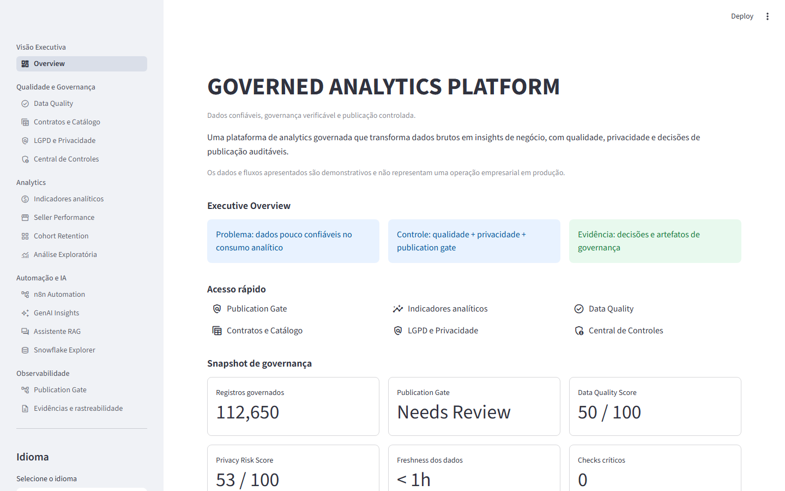

# Governed Analytics Platform — Documentação em português

O [README principal](README.md) é a documentação canônica em português, mantida para evitar divergências de funcionalidades, versões, métricas e comandos entre arquivos duplicados.

A plataforma demonstra como dados de e-commerce podem ser transformados em ativos analíticos com contratos, qualidade, privacidade, rastreabilidade e um Publication Gate com três decisões explícitas. Inclui Streamlit executivo modernizado em 14/11/2026, FastAPI com autenticação Bearer para endpoints sensíveis e RAG de governança com TF-IDF local.

A execução local de **13/11/2026** registrou **1.353 testes aprovados, nenhuma falha e 92% de cobertura em `src + app`**. Esses números não são métricas automáticas do CI. O pipeline é demonstrativo; a arquitetura Azure é proposta, não uma implantação em nuvem comprovada.

- [Documentação técnica completa e instruções de execução](README.md)
- [Aplicação Streamlit](https://governed-analytics-platform.streamlit.app/)
- [Versão em inglês](README.en.md)
- [Arquitetura e limitações](docs/architecture/architecture.md)
- [Implementação versus simulação](README.md#implementado-x-simulado)

## Capturas da interface

Capturas reais do Streamlit local em **1440 × 900** (escala 1:1), sem redimensionamento. Os resultados refletem o cenário demonstrativo e podem variar entre execuções. [Processo de captura](docs/operations/streamlit_capture_runbook.md).

[lgpd privacy risk](assets/screenshots/lgpd_privacy_risk.png) | [data quality](assets/screenshots/data_quality.png) | [governance control center](assets/screenshots/governance_control_center.png) | [privacy transformation preview](assets/screenshots/privacy_transformation_preview.png)
